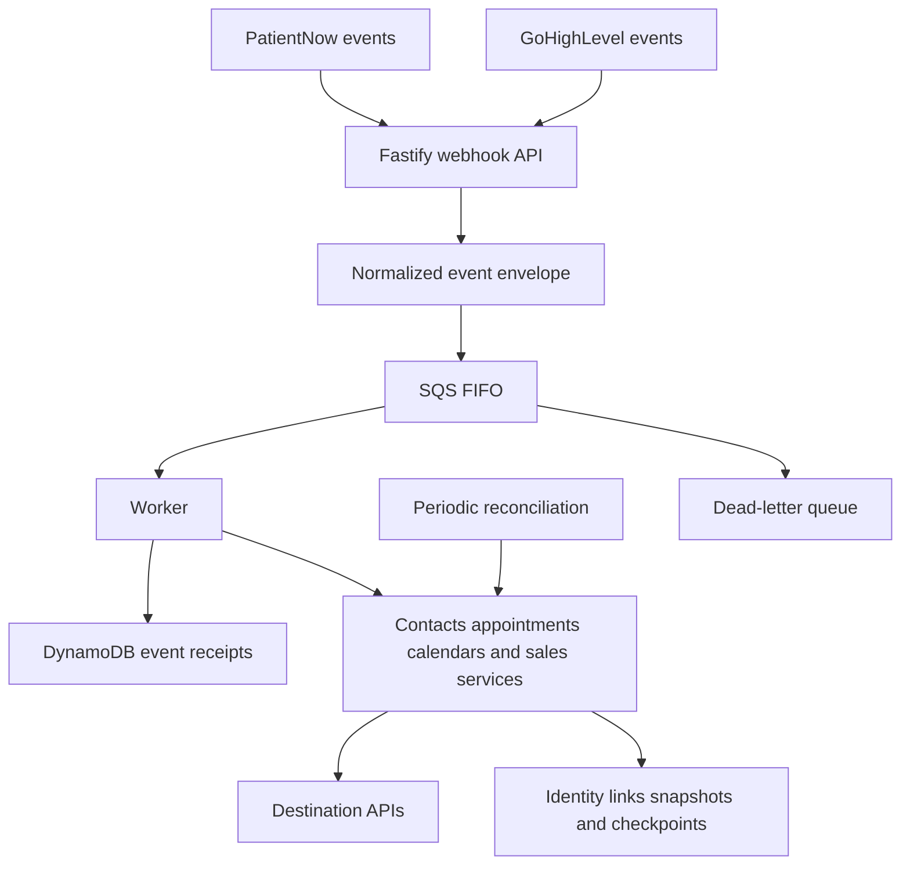

# PatientNow and GoHighLevel Integration

A TypeScript service for bidirectional synchronization between a practice-management platform and CRM workflows. Independently designed and implemented by [Artem Serdiuk](https://github.com/MeguMax).

The published source implements bidirectional contact and appointment synchronization, purchase-history processing, periodic jobs, dry-run operations, sync history and operational API routes. The broader project has since evolved into event-driven processing with recovery and reconciliation.

## Source snapshot

The public `main` branch is an earlier polling-based implementation. It contains the contact, appointment, purchase, API and scheduled-runner code. The webhook/SQS/DynamoDB implementation, provider-calendar extensions, automated test suite and Terraform deployment definitions described below belong to the newer working implementation and are not currently included in this public snapshot.

## Broader project engineering scope

- **Identity and consistency:** persisted cross-platform links, safe match resolution, stale-update handling and pending-create recovery.
- **Event processing:** normalized tenant-aware envelopes, ordered SQS FIFO groups, processing receipts in DynamoDB and message visibility renewal.
- **Recovery:** retries, dead-letter queue configuration, checkpoints and periodic reconciliation.
- **Appointments:** authoritative rereads, provider calendar mapping, outbound-event echo suppression, cancellation tombstones and timezone normalization.
- **Business records:** purchase-to-opportunity mapping with void and refund handling.
- **Operations:** separate API and worker entry points, protected administrative routes, production configuration validation and deployment documentation.

## Architecture of the newer implementation

API ingestion and synchronization work run separately. The deployment design uses one state-writing worker and ordered domain streams to preserve consistency across platform-specific IDs. API replicas can scale independently.

## Technical decisions

**Order events before resolving shared identity.** The platforms assign different IDs to the same logical record. FIFO groups therefore preserve ordering at the tenant/domain level while the worker resolves the persisted relationship.

**Make duplicate delivery explicit.** Processing receipts distinguish completed events, active work and retryable failures. Business services also check current records and identity links before applying changes.

**Treat cancellation as domain state.** A cancelled appointment retains enough identity and state to avoid accidental recreation during later reconciliation.

**Reconcile rather than trust webhooks alone.** Periodic scans and checkpoints provide a recovery path for changes that were missed or arrived in an unexpected shape.

## Stack

**Published source:** TypeScript, Node.js, Fastify, Axios and Zod.

**Newer implementation:** AWS SQS FIFO, DynamoDB, EFS and Docker. Terraform defines ECS/Fargate API and worker services, ALB/TLS, IAM access, queue recovery and CloudWatch logging.

## Validation

The newer working implementation includes automated regression tests for payload parsing, authorization, event identity, ordered processing, date/time handling, appointment changes, cancellation history, provider calendar reuse and refund mapping. Those tests are not included in the earlier public snapshot. Live service verification is a separate operation from the local test suite.

## Project discussion

I can walk through the synchronization model, an event's path from ingestion to destination, failure recovery, the single-worker consistency tradeoff and the tests behind a change using synthetic examples.

## Contact

[LinkedIn](https://www.linkedin.com/in/artem-serdiuk-4a3a15334/) · [GitHub](https://github.com/MeguMax) · [Upwork](https://www.upwork.com/freelancers/~014b478981bfacdaf1)
